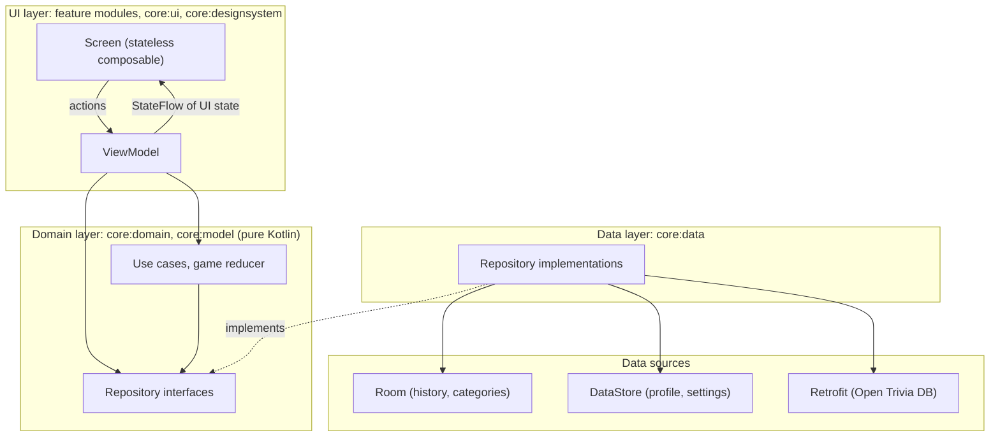

# Lumen

Lumen is a single-player Android quiz app built on the [Open Trivia DB](https://opentdb.com) API.
The player creates a profile, configures a quiz in the lobby and plays either a 10-question
**Classic** round or an endless **Marathon** that ends at the first mistake. Every question has a
15-second limit. Each finished game is saved to a local Room database together with all its
answers, and that history drives the history screen, a 7-day "80 % or better" streak challenge
and a marathon personal best. WorkManager reminds the player when the streak is at risk or the
app has not been opened for a while, and any result can be shared through the Android share sheet.

## Architecture

Lumen follows the official Android architecture guidance: **MVVM** with a **repository layer as
the single source of truth** and **unidirectional data flow** in Compose. [Link to diagram](https://mermaid.live/edit#pako:eNp9VNtu2zAM_RVBBYZkc7LmHrtAgS3d0A4LuuaGYfMeVJtOBNiSIclo0qL_PkpKmkuL-kUUxUMeHhJ-oolMgUY0y-VDsmLKkNnXWBD8dHW_VKxckfnN35jOb0jONqBILQNmKgXRx4AkEs-Kb40UNF8KvdEGinpM__k09psmCkBglt_rtbdJTRtmIAetbShpNEhMpfiSGC5FDcO8hW_4dEkW432yxdgnWnB4GCP5_AU_tSm_YyNnubnAiDl3nrOludjm8cUPc3nkAehblkFiDjATWRnwJZ350hmI9ESpK1kwbvv0xk4xr45zbaUqLO-AlKgj-bEYH6s1H1m9NZCEadDkE7mr-OME0ioBdRQ4gVLa2dhTcyPVhnBhQGUscbhSKqPfo8sMs2TxOKaKjvqrSieFijKHAgQKjHPSpDad3s7qARJI8ia5LUHM0vu7CrR93uPeYTOVlULeO0LaX49o_JQJyzHACnLNtU3oXBbg4eQzGeHIl2-81CZSnuzlLwWZ9mIra4MCgTUPQc7GQnAqSCHdVmw79fejamCUzLipv27Zbd0lzvno6qbpPfPRqceapNHcy65J860I9Lm-yQffHJ6emg-iAV0qntLIqAoCWoDCpcQrfbLvMTUrTB7TCE2FC7duJDKXuHSxeEZoycQf1HCHVrJarmiUsVzjrSpxbeCKM5zmPgR7BjWSlTA06ocuBY2e6JpG3fN-s9vttXuDsNNq91rtfkA3NBq2m_1-qxN2OoPz3qAbDp8D-uiKnjcH7WErDIedsBe2wmFAIbU7NfY_MPcfe_4P_4GHlA)

## Tech stack

| Area | Technology |
|---|---|
| Language | [Kotlin](https://kotlinlang.org) 2.4, [coroutines and Flow](https://kotlinlang.org/docs/coroutines-overview.html) |
| UI | [Jetpack Compose](https://developer.android.com/compose), [Material 3](https://m3.material.io), [Navigation 3](https://developer.android.com/guide/navigation/navigation-3) |
| DI | [Hilt](https://developer.android.com/training/dependency-injection/hilt-android) |
| Database | [Room](https://developer.android.com/training/data-storage/room) (1:N relation, indexes, type converters) |
| Preferences | [DataStore Preferences](https://developer.android.com/topic/libraries/architecture/datastore) |
| Network | [Retrofit](https://square.github.io/retrofit/) + [OkHttp](https://square.github.io/okhttp/) + [kotlinx.serialization](https://github.com/Kotlin/kotlinx.serialization) |
| Background work | [WorkManager](https://developer.android.com/topic/libraries/architecture/workmanager) |
| Images | [Coil](https://coil-kt.github.io/coil/) (local avatar files) |
| Tests | [JUnit 4](https://junit.org/junit4/), [kotlin.test](https://kotlinlang.org/api/core/kotlin-test/), [coroutines-test](https://kotlinlang.org/api/kotlinx.coroutines/kotlinx-coroutines-test/), [Turbine](https://github.com/cashapp/turbine), [Robolectric](https://robolectric.org), [MockWebServer](https://github.com/square/okhttp/tree/master/mockwebserver) |
| Quality | [Spotless](https://github.com/diffplug/spotless) + [ktlint](https://pinterest.github.io/ktlint/), [Android Lint](https://developer.android.com/studio/write/lint), [GitHub Actions](https://docs.github.com/actions) |
| Build | [AGP](https://developer.android.com/build) 9.4, [Gradle](https://gradle.org) 9.6, JDK 17, minSdk 33, target/compile SDK 37 |

## Documentation

- [Architecture](documentation/architecture.md): layers and their responsibilities
- [Database](documentation/database.md): Room ER diagram and tables
- [Design system](documentation/design.md): Lumora colors with their sources, typography, shapes
- [Development](documentation/development.md): requirements, adding a module, code style, tests

## Attribution

Questions come from [Open Trivia DB](https://opentdb.com), licensed under
[CC BY-SA 4.0](https://creativecommons.org/licenses/by-sa/4.0/).

## License

Lumen is released under the [MIT License](LICENSE). Third-party components keep their own
licenses: the Inter font under the [SIL Open Font License 1.1](https://openfontlicense.org),
the question data under [CC BY-SA 4.0](https://creativecommons.org/licenses/by-sa/4.0/), and the
libraries under the [Apache License 2.0](https://www.apache.org/licenses/LICENSE-2.0). The full
list with links is at the end of [LICENSE](LICENSE).
