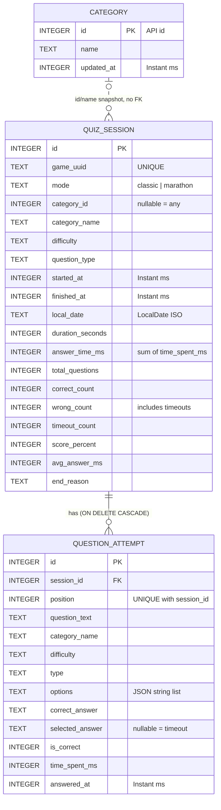

# Database and local storage

### ER diagram

[Link to diagram](https://mermaid.live/edit#pako:eNqtVd9v2jAQ_lcsP20SZeU3ibQHBOnE2rVdk0pbhWR5iUksJXZmO2sZ8L_vnBBaIGwvy1Ps7-6789139hqHMmLYxUzNOI0VzRYCwff1cf5EfM_353e3aLO5uJBr2PP8ANZkEgTel_sAuWiBE6rRO7CZeTde4KHpxJ9OZt77Ba54ppPA-3T38B1tZLtdcrzhtf48-iBoxpAWNNeJNC0kJLq6rv0P7NfVnv3mt8DrPSAeofvr1-3A-xagGPhIUQC0wI-3c0i7ZtubZHBoQMOUas1DtEEZVdQkUry1rGOE1LBYqhUpGUWRpvRHytBHRMXqhHlvbE91hEV8ueRhkZrVEfCzYNpwKYhZ5ew0AW2oMiwi1ED8uYClMCjTTbkuueA6-bttGTKVIU1JBNmC3Y1dzOz_3L9roo0KKI9NULNQikifWlChn5kihkPtMw2cusiQXKJyQ-dMGNKcsZEGEqkr0MAcSqVYaEgoC2FO4WclRVyBVk4iTIuI6TKuLExzyAo7x6ghIiM5UyFrgumvmOxOm-mjqjIREcWoBiGVwLZW8dHk_FvJ-2QYKBQKD_BVA5xLzW3d9lJHz9wkb7xOGv-qNfZi_od4DzVbbsm87CUk9dmHudVGcRGjlGtzOi-77lYVPQI1SwGzai7Rw-nbdbGpwVyTHW9z818FeUbH5wdoe3SvneskOE_u56ihAYe1rZ2K3M7i-bC4hWPFI-waVbAWzpjKqF3iMoEFNgkDWmyvVMi-eLkIZSqVdbeuORVPUma1t5JFnGB3SVMNqyr07vrfm4CUmZraCcHuqF9SYHeNX7Dbvxy2-_1BdzByep3uoNMdtvAKu-Nuezjs9Jxeb3Q5GPWd8baFf5dBL9uj7rjjOOOeM3A6zriFWcSNVF-qp6d8gbZ_ALYD9g8)

### Tables

- **`quiz_session`**: one row per finished game, with its configuration, timestamps, duration and
  totals.
- **`question_attempt`**: one row per question asked in a game (the 1:N relation). It stores the
  question, the options in the order they were shown, the correct answer, the player's answer
  (`null` for a timeout) and the time spent.
- **`category`**: a cache of the Open Trivia DB category list.